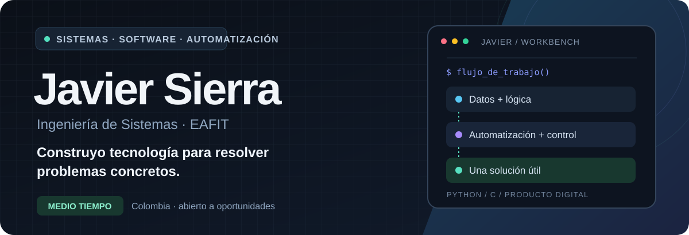
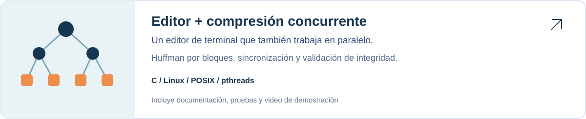
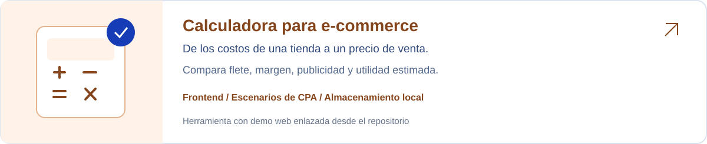

  

  

  
  
  

  <a href="#sobre-mí">SOBRE MÍ</a> &nbsp;·&nbsp;
  <a href="#stack">STACK</a> &nbsp;·&nbsp;
  <a href="#proyectos-destacados">PROYECTOS</a> &nbsp;·&nbsp;
  <a href="#experiencia">EXPERIENCIA</a> &nbsp;·&nbsp;
  <a href="#contacto">CONTACTO</a>

---

## Sobre mí

Estudio **Ingeniería de Sistemas en EAFIT** y disfruto construir herramientas que conecten la lógica del software con necesidades reales. Me muevo entre **sistemas y concurrencia**, **automatización con Python y APIs**, y **producto digital**. Haber trabajado con comercio electrónico y atención al cliente también me ayuda a pensar en quién va a usar lo que construyo.

<table>
  <tr>
    <td width="33%" valign="top">
      <h3>01 · Sistemas</h3>
      
Concurrencia, archivos, algoritmos y programación cercana al sistema operativo.

      C · Linux/POSIX · pthreads
    </td>
    <td width="33%" valign="top">
      <h3>02 · Automatización</h3>
      
Scripts e integraciones que conectan fuentes, reglas y acciones de forma clara.

      Python · APIs · n8n
    </td>
    <td width="33%" valign="top">
      <h3>03 · Producto</h3>
      
Herramientas que ordenan costos, escenarios y decisiones de comercio electrónico.

      E-commerce · operación · experiencia
    </td>
  </tr>
</table>

## Stack

  
  
  
  
  

  
  
  
  

## Proyectos destacados

<a href="https://github.com/javierandressm/editor-huffman-concurrente">Repositorio</a> · <a href="https://drive.google.com/file/d/1_BKVOteCt5HR5_ZXE5QCgXYV_zsN4btQ/view">Video de demostración</a> · <a href="https://github.com/javierandressm/editor-huffman-concurrente/blob/main/docs/Informe_Parcial_2_Huffman.md">Informe técnico</a>

<a href="https://calculadora-precios-recondy.vercel.app">Probar calculadora</a> · <a href="https://github.com/javierandressm/calculator-dropshipping">Ver código</a>

## Experiencia

<table>
  <tr>
    <td width="33%" valign="top">
      <h3>Comercio electrónico</h3>
      
Experiencia independiente en precios, pedidos, servicio al cliente y operación de tienda.

    </td>
    <td width="33%" valign="top">
      <h3>Revisión de calidad con IA</h3>
      
Evaluación de imágenes generadas por IA en un trabajo remoto para Mint Data.

    </td>
    <td width="33%" valign="top">
      <h3>Hackathon de automatización</h3>
      
Tercer puesto en una hackathon centrada en n8n.

    </td>
  </tr>
</table>

## Contacto

Busco **oportunidades de medio tiempo** compatibles con la universidad: desarrollo, automatización, soporte tecnológico, atención al cliente, ventas u operaciones.

  

  
<b>Disponibilidad por ciudad</b>

   
  Valledupar hasta enero de 2027; después, Medellín.

Proyectos personales, académicos y de colaboración identificados como tales. <a href="https://github.com/javierandressm?tab=repositories">Ver todos los repositorios ↗</a>

